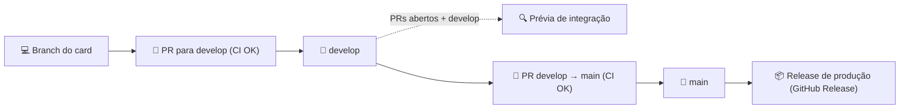

# 🚀 Guia de CI, Releases e Deploy — Margem.AI

Este documento descreve os workflows do GitHub Actions do projeto: o **CI** que valida cada PR, a **Prévia de integração** dos PRs abertos e a **Release de produção** publicada a cada merge na `main`, além de como voltar para uma versão anterior.

---

## 🏗️ 1. Visão Geral



| Workflow | Arquivo | Gatilho | O que faz |
| :--- | :--- | :--- | :--- |
| **CI** | `ci.yml` | Push em branches de trabalho, `develop` e `main`; PRs para `develop`/`main`; chamado pela release | Lint dos commits (em PRs), backend em H2 e em PostgreSQL, lint/testes/build do frontend; gera os artefatos `backend-jar` e `frontend-dist`. O job final **`CI OK`** resume tudo |
| **Prévia de integração** | `integration-preview.yml` | Push em `develop`, dias úteis às 11h UTC ou manual | Junta `develop` com todos os PRs abertos para `develop` e roda `scripts/check.sh`; o resumo mostra quais PRs conflitam ou quebram juntos |
| **Release de produção** | `release-prod.yml` | Push em `main` ou manual (`workflow_dispatch`) | Roda o `ci.yml` e publica no GitHub Releases os artefatos que o CI testou |

---

## ✅ 2. CI e regras de merge

`develop` e `main` só aceitam um PR quando o check **`CI OK`** passa **e** a branch está atualizada com a base. Depois que outro PR entra, atualize a sua (`git merge origin/develop`) e espere o CI rodar de novo.

Antes de fazer merge, confira o resumo da última execução da **Prévia de integração** (aba [Actions](https://github.com/ErickHTF/margemAI/actions)): se o seu PR conflita ou quebra junto com outro, resolva antes.

---

## 🚢 3. Release de produção

### Automático (merge na `main`)
1. Abra um PR de `develop` para `main` e aguarde o **`CI OK`**.
2. Faça o merge. O workflow **`Release de produção`** roda o CI de novo no commit da `main` e, se passar, publica uma Release com:
   * `margemai-backend-production.jar`
   * `margemai-frontend-production.zip`
3. A tag é `v0.1.<número de commits da main>` (ex.: `v0.1.312`), com notas de versão geradas automaticamente.

### Manual com tag customizada
1. Na aba [Actions](https://github.com/ErickHTF/margemAI/actions), abra **`Release de produção`** › **`Run workflow`**.
2. Selecione a branch `main` e informe `version_tag` (ex.: `v1.0.0`). Vazio usa a numeração automática.

### Deploy em margemai.site (`deploy.yml`)
Roda ao enviar uma tag `v*` (`git tag v0.1.N <commit>` e `git push origin v0.1.N`): publica o frontend no S3/CloudFront e atualiza o backend na EC2. Tags criadas pelo workflow de release não disparam o deploy; envie a tag manualmente.

### Voltando para uma versão anterior
* **Redeploy de versão estável:** envie uma tag nova apontando para o commit estável anterior.
* **Reverter o commit:** abra um PR com o `git revert` do commit problemático e faça o deploy com uma tag nova.

---

## 💻 4. Como Executar os Artefatos Baixados

### ☕ Executando o Backend (Java / Spring Boot)
Requisito: Java 21 instalado (`java -version`).

```bash
# Execução direta com porta padrão (8080)
java -jar margemai-backend-production.jar

# Execução com variáveis de ambiente customizadas
java -Dserver.port=8080 \
     -Djwt.secret="SUA_CHAVE_SECRETA_JWT_AQUI" \
     -jar margemai-backend-production.jar
```

### ⚛️ Servindo o Frontend (React / Vite Build)
O arquivo `.zip` contém os arquivos estáticos pré-compilados (`index.html`, `.js`, `.css`, assets).

* **Com Node.js (`serve`):**
  ```bash
  unzip margemai-frontend-production.zip -d dist
  npx serve -s dist -l 3000
  ```
* **Com Nginx:**
  Copie o conteúdo descompactado para a pasta `/var/www/html/` ou `/usr/share/nginx/html/`.

---

## 🔒 5. Variáveis de Ambiente e Configurações

| Variável / Propriedade | Padrão | Descrição |
| :--- | :--- | :--- |
| `SERVER_PORT` / `server.port` | `8080` | Porta HTTP da API backend |
| `JWT_SECRET` / `jwt.secret` | *(obrigatório em produção)* | Segredo HMAC-SHA (≥ 256 bits) para assinatura de tokens JWT. Injetado via variável de ambiente — nunca commitado |
| `JWT_ACCESS_TOKEN_EXPIRATION` / `jwt.access-token-expiration` | `3600` | Expiração do access token em segundos (1h) |
| `JWT_REFRESH_TOKEN_EXPIRATION` / `jwt.refresh-token-expiration` | `604800` | Expiração do refresh token em segundos (7 dias) |
| `SPRING_DATASOURCE_URL` | `jdbc:postgresql://localhost:5432/margemai` | URL de conexão com o banco de dados (PostgreSQL 16) |
| `SPRING_DATASOURCE_USERNAME` | `margemai` | Usuário do banco de dados |
| `SPRING_DATASOURCE_PASSWORD` | `margemai` | Senha do banco de dados |
| `VITE_API_BASE_URL` | `http://localhost:8080/v1` | URL base do backend consumida pelo frontend |

Todas as configurações são resolvidas a partir de **variáveis de ambiente** (com fallback padrão) diretamente no `application.properties`. Não há arquivo `.env`.

### Executando Localmente com Docker (PostgreSQL 16)

O backend usa **PostgreSQL 16** por padrão. Para subir o banco localmente com Docker:

```bash
cd backend
docker compose up -d
```

As credenciais padrão são `margemai` / `margemai` / banco `margemai`. Os dados ficam persistidos no volume `margemai_pgdata`.

Para executar o backend localmente, use o profile `local` (que já traz valores de desenvolvimento no `application-local.properties`) ou exporte as variáveis de ambiente:

```bash
SPRING_PROFILES_ACTIVE=local ./mvnw spring-boot:run
```

```bash
export JWT_SECRET=$(openssl rand -base64 48)
./mvnw spring-boot:run
```

> 💡 Os testes automatizados (`mvn test`) rodam em **H2 em memória** via `src/test/resources/application.properties` (com segredo JWT de teste separado), sem depender do Docker.
